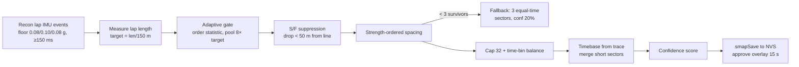
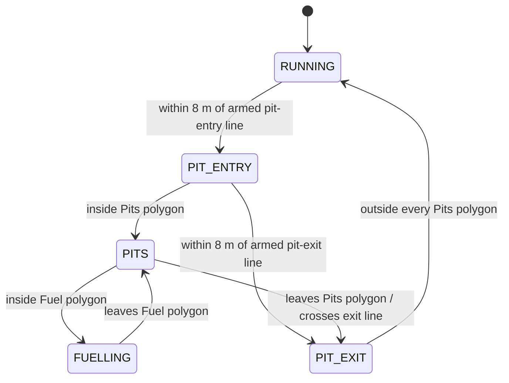
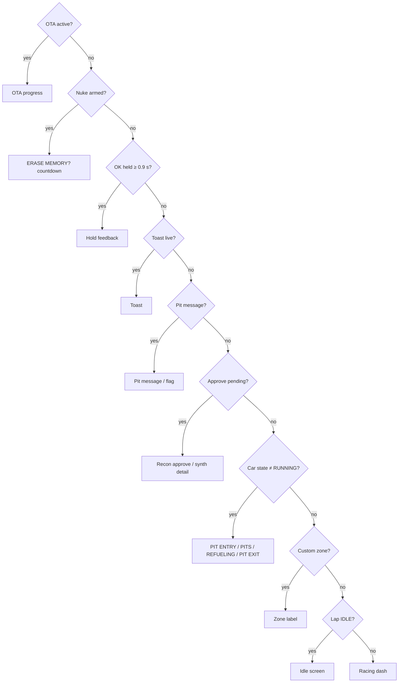
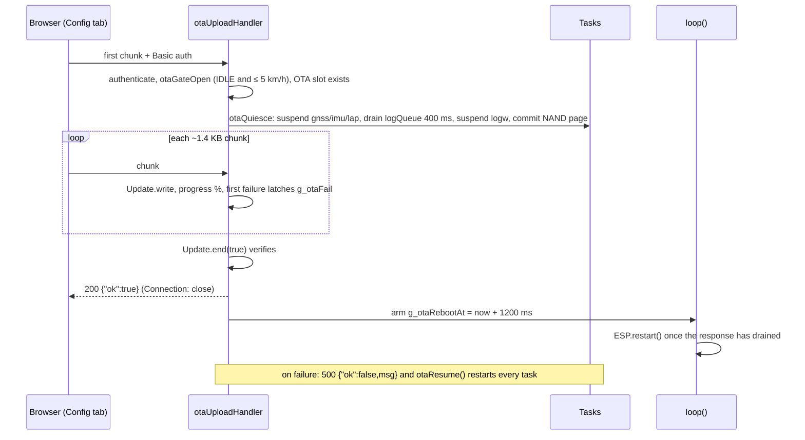

# Agile Firmware Pseudocode (v0.17.0)

Pseudocode of `LapTimer v0.17.0` (single-file Arduino sketch, ~9,200 lines). It follows the source section by section and keeps the real constant and function names, so any block here can be found in the source with a text search.

Conventions:

- `UPPER_CASE` names are `#define` constants from the source. Their v0.17.0 values are in the [constant tables](#16-key-constants).
- `g_*` names are globals. `ws_` is lapTask's working snapshot, `s` is a reader's copy.
- `→` means "set to". `//` lines are commentary, not source comments.
- Serial prints are left out. Every important event also goes to the NAND log via `sysLogEvent()`, and that call is kept.

Contents:

1. [Boot (`setup`)](#1-boot-setup)
2. [FreeRTOS task map](#2-freertos-task-map)
3. [Snapshot and shared state](#3-snapshot-and-shared-state)
4. [Button handling](#4-button-handling)
5. [gnssTask and GNSS configuration](#5-gnsstask-and-gnss-configuration)
6. [imuTask, axis remap and levelling](#6-imutask-axis-remap-and-levelling)
7. [lapTask: the main state machine](#7-laptask-the-main-state-machine)
8. [Sector map synthesis (recon lap)](#8-sector-map-synthesis-recon-lap)
9. [Reference matching, promotion and yaw learn](#9-reference-matching-promotion-and-yaw-learn)
10. [Geofence and car state](#10-geofence-and-car-state)
11. [Pit messages and race-control flags](#11-pit-messages-and-race-control-flags)
12. [displayTask: owner stack and screens](#12-displaytask-owner-stack-and-screens)
13. [NAND log store and logWriterTask](#13-nand-log-store-and-logwritertask)
14. [USB export mode](#14-usb-export-mode)
15. [Wi-Fi, web server and OTA](#15-wi-fi-web-server-and-ota)
16. [Key constants](#16-key-constants)

---

## 1. Boot (`setup`)

```text
setup():
    Serial.begin(115200)
    drive IMU_CS, TFT_CS, NAND_CS high                  // all SPI devices deselected
    OK(GPIO8), UP(GPIO11), DOWN(GPIO12) → INPUT_PULLUP

    spiSensor.begin(FSPI: SCK40 MISO41 MOSI38)          // IMU only
    spiDisplay.begin(HSPI: SCK5 MISO7 MOSI6)            // TFT + NAND share this bus

    imuOrientLoad()                                     // v0.19.0: NORMAL/INVERTED from NVS "lt_imu"
    tft.init(76, 284); rotation 3 (NORMAL) or 1 (INVERTED); invert off; delay 120ms   // order is load-bearing
    draw boot splash: "LapTimer v0.17.0", "booting..."

    if UP held:  runUsbExportMode()                     // never returns (§14)

    // --- IMU ---
    g_imu_ok ← configureIMU()                           // WHO_AM_I, ±16g, ±2000dps, 240Hz
    imuLevelLoad()                                      // roll/pitch/yaw trim from NVS "lt_imu"
    thrLoad()                                           // detection thresholds from NVS "lt_thr"
    if g_imu_ok and not imuCheckUpright(az):
        if az < −0.5:  boot line "IMU FLIPPED? HOLD OK 10s TO RELEARN"   // v0.19.0, never auto-flipped
        else:          boot line "IMU MOUNT? vert …G"
        sysLogEvent(IMU, WARN)

    // --- reference traces (PSRAM double buffer, 2 × 4500 × 12 B) ---
    a ← ps_malloc(...); b ← ps_malloc(...)
    if both ok:  refPoints ← a; curPoints ← b; g_traceDual ← true    // promotion armed
    else:        refPoints ← curPoints ← refFallback; g_traceDual ← false

    // --- GNSS ---
    g_gnss_ok ← configureGNSS()                         // §5
    if not g_gnss_ok and GNSS_DIAG_ON_FAIL: gnssDiagnose()   // serial-only bring-up report
    boot line: "GNSS 10Hz 460k8" | "GNSS 5Hz (want 10) nackN" | "GNSS FAIL"

    // --- storage ---
    g_log_ok ← logInit()                                // NAND init, recover, open LOG_nnnn.CSV
    preLogFlush()                                       // boot events buffered before the log existed

    // --- CAN (compiled out: CAN_ENABLED = 0) ---
    if CAN_ENABLED: install TWAI 500 kbit/s on GPIO1/2
    else: g_can_ok ← false

    // --- OTA slot line ---
    boot line "OTA app0>app1"  or  "OTA NO SLOT"

    geoMutex ← create mutex                             // MUST precede geoParseAndLoad (v0.13 fix)
    loadSFLine(); loadBestLap()                         // legacy point S/F + best lap from NVS
    g_mapAvailable ← smapLoad()                         // stored sector map, CRC-checked

    active ← geoGetActive()
    if active empty and _index holds exactly one circuit: adopt it as active
    if active: geoParseAndLoad(config) → zones + S/F line armed; sysLogEvent(GEO, INFO)
    else:      sysLogEvent(GEO, WARN, "no active circuit")

    loadWiFiCredentials()                               // NVS "pltd-wifi" overrides compiled default
    create queues: gnssQueue(1), imuQueue(1), canSectorQueue(8), logQueue(32 × 220 B)

    if DOWN held: runBootDiagScreens()                  // 5 pages, OK advances (§12.6)
    else if any fault (GNSS fail, rate < 10Hz, NACKs, IMU fail, single trace, no zones):
        delay BOOT_FAULT_HOLD_MS                        // 6 s so the fault can be read

    attach OK button ISR on CHANGE
    sysLogEvent(SYS, INFO, "boot v0.17.0 imu= gnss= log= nvs_wifi=")
    create tasks (§2)

loop():                                                 // runs every 100 ms
    once after BOOT_SETTLE_MS (5 s): reset g_lapWorstUs, g_dispWorstUs
    if g_otaRebootAt armed and reached: ESP.restart()   // deferred reboot after OTA / /reboot
```

## 2. FreeRTOS task map

| Task | Function | Core | Priority | Stack | Period | Role |
|---|---|---|---|---|---|---|
| `gnss` | `gnssTask` | 0 | 3 | 4096 | 20 ms | Drain autoPVT, measure epoch rate, `xQueueOverwrite(gnssQueue)` |
| `imu` | `imuTask` | 0 | 3 | 2048 | 5 ms (200 Hz) | Read IMU, remap + trim, IIR, levelling accumulator |
| `lap` | `lapTask` | 0 | 4 | 12288 | 10 ms (100 Hz) | Buttons, geofence, S/F crossing, lap/sector state machine, delta, logging, snapshot |
| `logw` | `logWriterTask` | 0 | 1 | 4096 | queue wait 250 ms | Only NAND writer after boot |
| `can` | `canTask` | 0 | 2 | 2048 | 20 ms | Compiled out (`CAN_ENABLED 0`) |
| `disp` | `displayTask` | 1 | 2 | 4096 | 50 ms (20 Hz) | Owner stack, TFT rendering, 10 Hz WebSocket `live` push |
| `wifi` | `wifiMonitorTask` | 0 | 1 | 3072 | 2 s | STA connect/retry, starts the web server on first connect |
| (async) | AsyncWebServer / AsyncTCP | lib | lib | lib | event | HTTP + `/ws` handlers |

## 3. Snapshot and shared state

```text
// One stable LapSnapshot_t, copied in and out under a spinlock (BUG-01 fix).
publishSnapshot(src): enter critical(snapMux); memcpy(g_snap ← src); exit critical
copySnapshot(dst):    enter critical(snapMux); memcpy(dst ← g_snap); exit critical

// Writers: lapTask only (once per 10 ms iteration).
// Readers: displayTask, canTask, buildDataJson (/data), otaGateOpen.
```

Other cross-task channels:

| Channel | Producer → consumer | Notes |
|---|---|---|
| `gnssQueue` (depth 1, overwrite) | gnssTask → lapTask | latest PVT only |
| `imuQueue` (depth 1, overwrite) | imuTask → lapTask | latest IMU sample only |
| `logQueue` (32 rows) | lapTask, sysLogEvent → logWriterTask | non-blocking send, drops counted in `g_logDropped` |
| `pitMsgs[4]` + `pitMux` | WS handler → displayTask / lapTask sweep | spinlock |
| `geoZones[]` + `geoMutex` | /geo/load, boot → lapTask | every take has a finite timeout (0 or 50 ms) |
| volatile flags | web handlers → tasks | `g_nukeReq`, `g_imuLevelReq`, `g_wifiReconnectReq`, `g_otaRebootAt` |

## 4. Button handling

```text
// OK button (GPIO8): CHANGE interrupt measuring press duration.
onButtonISR():
    if pin LOW (press) and debounced: btnFallMs ← now; btnDown ← true
    else (release):
        btnDown ← false; dur ← now - btnFallMs
        dur  25..699 ms   → btnShortEvt
        dur  700..1199 ms → ignored guard band
        dur  1200..9999   → btnLongEvt
        dur  ≥ 10000      → btnVLongEvt

// UP button (GPIO11): no ISR. Read at power-on (USB export) and polled by lapTask (nuke hold).
// DOWN button (GPIO12): no ISR. Read at power-on (diag pages) and by displayTask on the approve screen.
```

| Input | Context | Action |
|---|---|---|
| UP held at power-on | boot | USB log export mode |
| DOWN held at power-on | boot | 5 diagnostic pages |
| OK short | nuke countdown armed | cancel the reset |
| OK short | approve overlay | keep the new sector map |
| OK short | idle, map prompt shown | use stored map, skip recon |
| OK long (1.2–10 s) | any | set legacy S/F point at current fix, erase sector map, reset to IDLE |
| OK very long (≥ 10 s) | any | IMU level (roll/pitch) capture |
| UP held 10 s | stopped (< 2 km/h), not racing | arm learned-state reset, 5 s countdown |
| DOWN held | approve overlay | show synthesis breakdown |
| OK held ≥ 0.9 s | any | hold-feedback screen shows what release will do |

## 5. gnssTask and GNSS configuration

```text
configureGNSS():
    for baud in [460800, 115200, 9600, 38400], 3 attempts each:
        Serial1.begin(baud, rx=GPIO18, tx=GPIO17); if myGNSS.begin(): connected
    if none: return false
    if connected baud ≠ 460800:
        setVal32(CFG-UART1-BAUDRATE, 460800)            // ACK is lost at the new rate
        re-attach at 460800 (5 tries) else fall back to the connected baud
    VSET (checked, one retry, NACKs counted in g_gnssNacks):
        UART1 in UBX, out UBX, out NMEA off
        CFG-RATE-NAV 1
    for attempt in 0..1:                                 // verify rate by readback
        CFG-RATE-MEAS ← 1000 / wantHz                    // 100 ms first
        read back; if equal: break
        wantHz ← GNSS_RATE_FALLBACK_HZ (5)
    dynamic model ← AUTOMOTIVE
    g_gnssAutoPvt ← setAutoPVT(true)                     // receiver pushes PVT
    g_gnss_hz ← 1000 / measured readback
    sysLogEvent(GNSS, INFO|WARN, rate, baud, autoPVT, nacks, band plan)
    return g_gnss_hz > 0

gnssTask():  every GNSS_TASK_PERIOD_MS (20 ms)
    if myGNSS.getPVT(autoPVT ? 0 : 50):
        g_gnssEpochs++
        track worst inter-epoch gap → g_gnssWorstGap
        every 10 s window: g_gnssMeasHz ← epochs / window
        build PVTData_t (lat/lon 1e-7°, speed km/h, heading, SIV, PDOP, fix, iTOW, UTC)
        xQueueOverwrite(gnssQueue, pvt)
```

## 6. imuTask, axis remap and levelling

```text
imuReadData():
    burst-read accel XYZ and gyro XYZ (raw int16, package frame)
    convert: accel × 0.004788 m/s² per LSB, gyro × 0.070 dps per LSB
    // 1. structural remap, IMU_MOUNT = MOUNT_DASH_VERTICAL (board vertical, face forward, pin 1 up)
    fwd ← +Z, left ← +Y, up ← −X, yaw rate ← −gX
    // 1b. v0.19.0 orientation: INVERTED = unit rolled 180° about forward
    if g_imuOrient = INVERTED:  left ← −left; up ← −up; yaw rate ← −yaw rate
    publish raw vehicle-frame triple for the levelling accumulator
    // 2. gravity trim (roll then pitch, from NVS)   3. yaw offset (manual, from NVS)
    rotate (fwd, left, up) by roll, pitch, yaw
    // 4. IIR filter for the event detector
    filt_x ← 0.25·(fwd/g) + 0.75·filt_x ;  filt_y likewise for lateral
    return ImuData_t {accel_x/y/z, yaw_dps, filt_x, filt_y, timestamp}

imuTask():  every IMU_POLL_PERIOD_MS (5 ms)
    d ← imuReadData(); xQueueOverwrite(imuQueue, d)
    if g_imuLevelReq and not started: g_imuLevelBusy ← true; clear sums
    if g_imuLevelBusy:
        accumulate raw triple, |a|, |a|²
        after IMU_LEVEL_SAMPLES (200, ≈1 s):
            mean |a| in 0.85..1.15 g and sd ≤ 0.05 g ?
              yes and az < −0.5 g:  // v0.19.0: installed the other way up
                   pending roll ← atan2(−ay, −az); pending pitch ← atan2(−ax, √(ay²+az²))
                   result ← FLIP (lapTask decides: LAP_IDLE and ≤ 5 km/h ?
                     yes: save orientation + trim, toast "ORIENTATION / FLIPPED - REBOOTING",
                          loop() commits the NAND page and restarts after 2.5 s
                     no:  toast "ORIENT FLIP / BLOCKED - STOP CAR", nothing saved)
              yes: roll ← atan2(ay, az); pitch ← atan2(−ax, √(ay²+az²))
                   save NVS, reset IIR, result ← OK (toast "IMU RESET / SUCCESSFULLY")
              no:  result ← FAIL (toast "IMU RESET / FAILED - HOLD STILL")
            g_imuLevelBusy ← false; g_imuLevelReq ← false

imuCheckUpright(): average 20 × vertical g; < 0.5 g means board upside down or wrong preset
```

## 7. lapTask: the main state machine

The lap state (`LAP_IDLE → LAP_RECON → LAP_RACING`) and the car state (`RUNNING / PIT ENTRY / PITS / FUELLING / PIT EXIT`) are independent. Car state gates timing; it never changes the lap state.

```text
lapTask():  every 10 ms (100 Hz)
    newGNSS ← receive gnssQueue (non-blocking);  receive imuQueue (latest)

    // --- GNSS interval and staleness ---
    if newGNSS and iTOW changed: g_gpsIntervalMs ← EMA(¾ old + ¼ measured)
    gnssStale ← no new iTOW for > GNSS_STALE_MS (1.5 s)        // logs STALE / recovered on change
    gnssValid ← have PVT and not stale and fix ≥ 2 and SIV ≥ 6 and PDOP ≤ 4.0

    // --- learned-state reset ("nuke") ---
    if UP held ≥ 10 s and speed < 2 km/h and state ≠ RACING and not armed:
        g_nukeArmed ← true; g_nukeArmUntil ← now + 5 s      // display shows countdown
    if armed and countdown expired: g_nukeReq ← true
    if g_nukeReq:                                            // from UP hold or POST /nuke
        nukeLearnedState(alsoSF)                             // see table below
        state ← IDLE; reset lap/sector/delta/map flags
        toast "MEMORY / CLEARED" (or "CLEARED + S/F")

    // --- buttons ---
    if btnVLongEvt: request IMU level; toast "IMU RESET / SAMPLING - HOLD STILL"
    if level result ready: toast success or failure
    if btnLongEvt:
        if gnssValid: saveSFLine(current fix); toast "S/F SET"
        else:         toast "S/F NOT SET / NO GNSS FIX"
        smapErase(); state ← IDLE; clear traces, sectors, candidates, map acceptance
    if btnShortEvt:
        if nuke armed:                         cancel; toast "RESET / CANCELLED"
        elif approvePending:                   approvePending ← false     // keep map
        elif IDLE and notice = MAP_PROMPT:     load stored map into sectors[];
                                               mapAccepted ← true; notice ← MAP_LOADED
    if approvePending and now ≥ approveUntil: approvePending ← false      // 15 s silence = consent

    // --- pit messages ---
    expired ← pitMsgSweep(); if expired: ws.textAll({"t":"pitack","id":…,"by":"timeout"})

    // --- geofence ---
    if newGNSS and gnssValid: carState ← updateCarState(lat, lon, carState)     // §10

    // --- start/finish crossing ---
    sfCrossed ← false
    if newGNSS and gnssValid and g_sfLineValid:              // v0.16 line S/F
        if have previous fix and speed > 10 km/h:
            t ← sfCrossFraction(prev → current)              // segment intersection, −1 if missed
            if t ≥ 0:
                dir ← sign of sfSide(current)
                if g_sfDir unset: g_sfDir ← dir              // direction learned on first cross
                if dir = g_sfDir and ≥ 15 s since last crossing: sfCrossed ← true; crossFrac ← t
        prev ← current
    elif newGNSS and gnssValid and g_sf_valid:               // legacy point S/F
        enter 15 m circle while armed and > 10 km/h → sfCrossed; re-arm outside 30 m
    crossTOW ← iTOW − (1 − crossFrac) · g_gpsIntervalMs      // millisecond interpolation

    // --- timing gates ---
    onTrack ← carState = RUNNING
    stationary ← speed < 3 km/h for ≥ 2 s
    timingLive ← onTrack and not stationary
    if timingLive just became true and reference ready:
        re-anchor refMatchIdx by full-trace nearest search (< 30 m)

    switch state:
      case LAP_IDLE:
        if stored map exists and not accepted and within 500 m of its S/F: notice ← MAP_PROMPT
        if sfCrossed:
            start lap clock (lapStartTOW, lapStartMs, start position); lap 1
            if mapAccepted: state ← RACING                   // trace rebuilt this lap, delta from lap 2
            else: clear candidates, styleReset(); state ← RECON

      case LAP_RECON:
        if speed > 5 km/h: styleAccumulate(filt_x, filt_y)   // 64-bin G histograms
        on each valid fix: append (lat, lon, elapsed) to curPoints
        if speed < 5 km/h for > 10 s: abort → IDLE, notice ← RECON_ABORT
        event detector on filtered G, RECON_FLOOR thresholds (0.08 / 0.10 / 0.08 g):
            braking if fwd < −0.08, else cornering if |lat| > 0.10, else accel if fwd > 0.08
            on onset: remember type, time, GPS position, trace index, peak
            while same type: track peak
            on change: if duration ≥ 150 ms push CandidateEvent (max 256)
        movedFromStart ← > 50 m from the start point
        if sfCrossed and movedFromStart and lap > 30 s:
            synthPending ← true                              // synthesis deferred one iteration
            best lap ← lapMs if better
            tracePromote(lapMs)                              // recon lap becomes the reference
            latchLastLap(1, lapMs, 0, promoted)
            start lap 2; yawAccReset(); state ← RACING

      case LAP_RACING:
        lapElapsed ← iTOW − lapStartTOW
        append fix to curPoints (dual buffer, or first lap only in single-buffer fallback)
        yawAccumulate(pvt, imu)
        if gnssStale: liveDeltaValid ← false
        if newGNSS and gnssValid and reference ready and timingLive:
            window ← 80 points; widen to 400 after 25 misses, full trace after 50
            idx ← findNearestRefPoint(...)                   // §9, heading-gated
            if idx found: liveDelta ← lapElapsed − refPoints[idx].elapsed; valid
            else: misses++; after 3 misses liveDeltaValid ← false

        // sector completion with lookahead (BUG-02)
        if valid fix and movedFromStart and sectors remain and cooldown elapsed:
            lookEnd ← currentSector + 1 + 3   (all remaining if reference progress shows a skip)
            matched ← first boundary j in [currentSector, lookEnd) within 30 m
            if matched:
                mark skipped sectors (currentSector..matched−1) gray, no time
                sectorElapsed ← iTOW − sectorStartTOW
                refDurSum ← Σ ref_dur of spanned sectors
                delta ← sectorElapsed − refDurSum
                gray if: any spanned ref_dur < minRefDurMs, not rejoined since pits,
                         refDurSum = 0, or |delta| > DELTA_SANITY_MS
                colour ← gray(0) | green(1) if delta < −10 ms | red(2) if delta > +10 ms
                if not gray: cumulativeDelta += delta
                queue CAN sector event; currentSector ← matched + 1

        // lap complete
        if sfCrossed and movedFromStart and lap > 30 s:
            lapMs ← crossTOW − lapStartTOW
            if not lapPitted and better than best: saveBestLap; sysLogEvent "NEW BEST"
            promote ← not lapPitted and (no reference or lapMs < refLapMs)
            if promote and > 50 trace points:
                if every sector completed with a time:
                    sector ref times ← this lap's times; smapSave(..., conf 90)
                tracePromote(lapMs)                          // pointer swap
            latchLastLap(lapNumber, lapMs, cumulativeDelta, sectors, promote)
            yawSolve()
            reset for next lap: lapPitted ← false; rejoined ← (carState = RUNNING); lapNumber++

    // --- logging (enqueue only) ---
    if IDLE and moving > 2 km/h: one row per second
    if not IDLE and newGNSS: one row per epoch while moving, keepalive every 10 s when stopped

    // --- pit bookkeeping ---
    if not IDLE: if carState ≠ RUNNING: lapPitted ← true; rejoined ← false
                 elif not rejoined and timingLive: rejoined ← true

    // --- deferred synthesis (one iteration after the recon crossing) ---
    if synthPending:
        styleClassify(); synthesiseSectors(synthLapMs, sr)   // §8
        reject the map if 0 sectors or any zero duration
        load sectors[] from sr; if sr.count > 0: smapSave; g_mapAvailable ← true
        approvePending ← true; approveUntil ← now + 15 s
        if sr.fallback: notice ← LOW_EVENTS

    // --- publish snapshot ---
    clamp liveDelta and cumulativeDelta to ±DELTA_SANITY_MS (10 min)
    bar_state ← OFF    if state ≠ RACING
                NOREF  if no reference / no sectors / delta invalid
                GRAY   if the active sector's ref duration is too short
                OK     otherwise
    estimated_lap ← elapsed + (reference total − reference time at matched point)
    level_stale ← |fwd g| averaged over 3 s stationary > 0.12 g (clears < 0.09 g)
    fill every other snapshot field; publishSnapshot(ws_)

    // --- vitals ---
    track worst loop time; every 60 s sysLogEvent(SYS, INFO, uptime, heap, wifi, GNSS, timing, drops, states)
```

Learned-state reset (`nukeLearnedState`):

| Wiped | Kept |
|---|---|
| Sector map (NVS `lt_smap`), best lap (NVS `lap_best`), reference and current traces, candidates, style histogram and gate, synthesis diagnostics, yaw suggestion | S/F line (unless "also forget S/F"), geofence circuits and zones, Wi-Fi credentials, IMU trim and yaw offset, detection thresholds |

## 8. Sector map synthesis (recon lap)

```text
synthesiseSectors(lapMs, out):
    trace ← refPoints[0..refPointCount)          // the recon lap, already promoted (v0.15.1 fix)
    if trace < 20 points: abort, no sectors, log SYNTH WARN

    // 0. measure the lap and derive spacing
    lapMeters ← Σ distance along trace
    target ← clamp(round(lapMeters / 150 m), 6, 32)
    spacingM ← clamp(lapMeters / (target × 1.3), 40 m, 250 m)
    spacingMs ← SYNTH_MIN_SECTOR_MS (1200 ms)

    // 1. adaptive gate (order statistic) + S/F suppression
    sort candidate peaks descending
    pool ← min(target × 8, 256)
    gate ← peak[pool−1] (or weakest peak if fewer), floored at 0.08 g
    keep candidate if peak ≥ gate and ≥ 50 m from S/F

    // 2. strength-ordered spacing suppression
    repeat: take strongest unaccepted kept candidate, accept it,
            drop every other kept candidate within spacingM or spacingMs of it

    // 3. floor
    if survivors < 3: fallback → 3 equal-time sectors, confidence 20, return

    // 4. cap and balance (only if survivors > 32)
    pass 1: strongest candidate per 1/20th-of-lap time bin
    pass 2: fill remaining slots by global strength

    // 5. timebase
    boundary time ← trace[candidate.ref_idx].elapsed; durations = differences
    merge any sector shorter than spacingMs into its neighbour

    // 6. confidence (0..100)
    conf ← 40·min(1, count/10) + 30·max(0, 1 − CV(durations)) + 30·min(1, gnssHz/10)

    record every stage in g_synthDiag; sysLogEvent(SYNTH, "lap … | target … | cand … gate … | drop … | FINAL n conf %")

styleClassify():  p95 lateral < 0.15 g SLOW RECON | < 0.30 ROAD | < 0.60 BRISK | else TRACK
```



## 9. Reference matching, promotion and yaw learn

```text
findNearestRefPoint(lat, lon, startIdx, window, heading, speed):
    search refPoints[startIdx − 20 .. startIdx + window) for the closest point within 30 m
    if speed > 20 km/h and |heading − local reference bearing| > 60°: reject   // wrong track leg
    return index or −1

tracePromote(lapMs):                       // two pointer assignments, nothing copied
    if g_traceDual: swap(refPoints, curPoints)
    refPointCount ← curPointCount; refLapMs ← lapMs; refPathReady ← count > 0; curPointCount ← 0

latchLastLap(n, ms, delta, sectors, promoted):
    copy lap number, time, delta, per-sector times and deltas into g_lastLap*
    // served as /data last_lap and last_sectors; fixes the "Lap 0.400" race

yawAccumulate(pvt, imu):                   // GPS truth vs IMU, only when meaningful
    skip below 40 km/h, |yaw rate| > 40 °/s, |aLong| > 0.6 g, or tiny signals
    aLong ← dv/dt from GNSS speed;  aLat ← −v·ω from GNSS heading
    accumulate running sums for a mean-removed 2D Procrustes fit

yawSolve():                                // at each lap end
    need ≥ 1500 samples
    ψ ← atan2(Sxy, Sxx) of the mean-removed cross sums; confidence ← correlation × 100
    if previous lap within 5°: suggestion ← mean of both (shown in web IMU card, never auto-applied)
```

## 10. Geofence and car state

```text
geoParseAndLoad(json):                     // from /geo/load or boot auto-load
    take geoMutex (50 ms)
    for each zone (max 10, 32 vertices): copy type, label, colour, vertices; active, disarmed
    if zone is ZONE_SF_LINE:
        warn if vertex count ≠ 2
        A ← v0, B ← v1; length ← distance(A, B)
        g_sfLineValid ← length ≥ SF_MIN_LENGTH_M (8 m); g_sfDir ← 0 (relearn)
        legacy point ← midpoint (map prompt and S/F suppression still use it)
        sysLogEvent(GEO, INFO|WARN, points, length, endpoints)

updateCarState(lat, lon, current):        // every valid fix, geoMutex take with 0 timeout
    for each active zone:
        PIT_ENTRY_LINE: > 8 m from line → arm; within 8 m while armed and RUNNING → PIT_ENTRY
        PIT_EXIT_LINE:  > 8 m → arm; within 8 m while armed and (PITS or PIT_ENTRY) → PIT_EXIT
        PITS polygon:   inside while PIT_ENTRY → PITS; outside while PITS → PIT_EXIT
        FUEL polygon:   inside while PITS → FUELLING; outside while FUELLING → PITS
        CUSTOM polygon: inside → display override with the zone label (first match wins)
        SF_LINE:        ignored here (lap state machine)
    if current = PIT_EXIT and outside every PITS polygon → RUNNING
```



## 11. Pit messages and race-control flags

```text
pitMsgPush(text, pri, bg, fg, latched):    // queue of 4, spinlock
    same text present → replace in place; else first free slot;
    else replace the oldest unlatched message; else reject (all 4 latched)
pitMsgClearByName(text)                    // lifts a latched flag
pitMsgSweep():  remove unlatched messages older than PITMSG_TIMEOUT_MS (5 s)
pitMsgCurrent(): highest priority, newest first

WS "pitmsg" {text, pri}:  pri clamped to 0..1; white on blue (0x213F); push unlatched;
                          broadcast {"t":"pitshown","id"}
WS "pitflag" {name, on}:  on  → push latched, priority 2:
                                 RED FLAG white on red, SAFETY CAR black on orange,
                                 anything else (YELLOW FLAG) black on yellow
                          off → pitMsgClearByName
                          broadcast flagstate to every client
WS "pitstate":            broadcast flagstate
```

The driver cannot clear any pit message. Requests expire after 5 s; flags stay until the engineer lifts them.

## 12. displayTask: owner stack and screens

### 12.1 Owner resolution (20 Hz)

```text
displayTask():  every 50 ms on core 1
    s ← copySnapshot();  havePit ← pitMsgCurrent(pm)
    every 2nd frame: wsPushLive(s)                         // 10 Hz {"t":"live",…}
    owner ← first true of:
        OTA in progress            → OWN_OTA
        nuke armed                 → OWN_NUKEARM
        OK held ≥ 0.9 s            → OWN_BTNHOLD
        toast not expired          → OWN_TOAST
        pit message present        → OWN_PITMSG
        approve pending            → OWN_APPROVE
        car state ≠ RUNNING        → OWN_CARSTATE
        inside custom zone         → OWN_CUSTOM
        lap state = IDLE           → OWN_IDLE
        else                       → OWN_NORMAL (racing dash)
    ownerChanged → full repaint of the new owner, otherwise dirty-checked partial updates
```



### 12.2 Racing dash (`OWN_NORMAL`)

```text
barRangeUpdate(live_delta, bar_state = OK)
    ladder 0.5, 1, 2, 5, 10, 20, 30 s: grow at once when |delta| exceeds the scale,
    shrink one step only after 12 s spent below the next step down
barSmoothed ← EMA(0.35) of live_delta (snap on arm)
drawDeltaBarTime(barSmoothed, bar_state)   // y 0..27
    OFF   → black + centre pip
    NOREF → dim amber box 96×10 at centre
    GRAY  → gray box 96×10 at centre
    OK    → fill from centre pip: losing (delta > 0) RED to the LEFT, gaining GREEN to the RIGHT
            fraction with soft knee: inner half of the bar = first 25 % of full scale
            scale label ("1s", "500ms", …) top right when it changes
drawInfoRow()                              // y 29..50, size 2
    left:  cumulative sector delta ±s.mmm (red > +10 ms, green < −10 ms, gray otherwise)
    right: estimated lap m:ss.mmm (only when > 0)
drawSectorBar()                            // y 52..73
    one segment per detected sector, width 284 / count (8 px at 32)
    completed → gray / green / red; active → dark gray with a white 2/3 block biased
    toward the gaining (right) or losing (left) side; pending → dark gray; no map → one dark slab
```

### 12.3 Idle screen (`OWN_IDLE`)

```text
row 1 (y 2, size 1, cyan):   "Mullaloo Motorsport Engineering"
row 2 (y 12, size 1, gray):  "AGILE - Predictive Delta Timer"
row 3 (y 24, size 2, 21 chars max):
    MAP_PROMPT  yellow  "MAP n SEC: OK=USE HOLD=NEW"   (cut to 21 chars on the panel)
    MAP_LOADED  green   "MAP OK - CROSS LINE"
    RECON_ABORT orange  "RECON ABORTED"
    LOW_EVENTS  orange  "CHECK IMU MOUNT"
    none        orange  "LEVEL ME" if level_stale
                white   "DRIVE TO START LINE" (S/F known) / "DRIVE TO START & SET"
row 4 (y 48, size 1, 4 Hz):  "SAT n PDOP x.x <circuit|NO CIRCUIT> S/F:<LINE|PT|NONE>"
row 5 (y 66, size 1, dark):  "LapTimer v0.17.0  <IP when Wi-Fi up>"
```

### 12.4 Full-screen overlays

All use `drawCentredText(line1 size 3, line2 size 2, bg, fg)`.

| Owner | Line 1 | Line 2 | Colours (text on background) |
|---|---|---|---|
| Pit request | message text | – | white on blue |
| YELLOW FLAG / SAFETY CAR / RED FLAG | flag name | – | black on yellow / black on orange / white on red |
| Approve | `<STYLE> n SEC` | `OK=KEEP HOLD=REDO ns` | cyan on black |
| Car state | PIT ENTRY / PIT EXIT / PITS / REFUELING | SLOW DOWN / PUSH / – / – | black on white, black on white, orange on black, black on orange |
| Custom zone | zone label | – | white on gray |
| Nuke armed | ERASE MEMORY? | `OK=CANCEL  wiping in ns` | orange on black |
| Button hold | HOLD... / SET S/F / IMU RESET | RELEASE = NO ACTION / HOLD 10s = IMU RESET / RELEASE NOW | gray / cyan / green on black |
| Toasts | S/F SET, S/F NOT SET, IMU RESET, MEMORY, RESET | NO GNSS FIX, SAMPLING - HOLD STILL, SUCCESSFULLY, FAILED - HOLD STILL, CLEARED, CLEARED + S/F, CANCELLED | see [Display.md](Display.md) |

### 12.5 OTA screen (`OWN_OTA`)

```text
title "FIRMWARE UPDATE" | "REBOOTING" (cyan) or "OTA FAILED" (red), size 2
progress frame 272×18, fill green (red on failure)
" nn%  <status>" line, then "DO NOT POWER OFF" (amber) or "resuming - nothing written"
every element dirty-checked so the SPI bus stays quiet while Update.write() runs
```

### 12.6 Boot diagnostic pages (DOWN held at power-on)

| Page | Content |
|---|---|
| 1/5 FIRMWARE | version, free heap, free PSRAM, trace DUAL/SINGLE, flash size |
| 2/5 GNSS | baud, requested vs actual rate, Hz OK/BELOW TARGET, measured Hz and worst gap, band plan |
| 3/5 IMU | mount preset and orientation, roll/pitch trim, yaw offset, vertical g check, thresholds |
| 4/5 STORE | session id, pages used/total, % used, sessions stored, armed circuit and S/F type |
| 5/5 WIFI | SSID, state, IP, RSSI, "OK to exit" |

## 13. NAND log store and logWriterTask

```text
nandInit():  reset; JEDEC must be EF AA 23 (W25N04KV); clear SR-1 block protect;
             ensure ECC-E and BUF set; scan page 0 spare byte of all 4096 blocks → good-block map

logRecover():
    write head ← binary search for the first erased logical page
    sessions   ← walk used pages, binary search the end of each session's contiguous run
    if the last page's CRC is bad: trim it (interrupted program)

logOpenSession():  id ← last + 1 (max 9999); name LOG_nnnn.CSV; append CSV header

logEnqueueRow(...):  (lapTask)  format one CSV row (≤ 220 B); xQueueSend(logQueue, 0 wait); drop counted
sysLogEvent(src, sev, fmt):     "# m=<millis> SRC/SEV text" row; before the store is up → 12-slot pre-log ring

logWriterTask():
    loop: receive row (250 ms wait) → logAppendBytes(row + "\n")
          if a partial page is older than LOG_FLUSH_MS (5 s): logProgramCurrentPage()

logProgramCurrentPage():
    pad remaining payload with one "#pad" comment row
    header {magic "1PAP", session, payload_len 2032, seq, CRC32}; program page at write head
    write head++; if full: g_log_full ← true (logging stops)
```

CSV columns: `iTOW, lat_deg, lon_deg, speed_kph, sats, pdop, fix, along_g, lat_g, vert_g, yaw_dps, lap, sector, delta_ms, cumul_delta_ms, state, car_state, geo_override, geo_label`.

## 14. USB export mode

```text
runUsbExportMode():                       // UP held at power-on; no tasks are created
    nandInit(); logRecover(); fatAssignClusters()          // contiguous clusters per session
    TFT: "USB LOG EXPORT", sessions + MB used, connect hint, "Hold OK 5s = ERASE ALL LOGS"
    TinyUSB MSC: vendor "MULLALOO", product "PLTD LOG STORE", read-only
        onRead(lba): synthesise FAT16 on the fly
            LBA 0 boot sector | FAT1, FAT2 (cluster chains) | root dir (LOG_nnnn.CSV entries) |
            data clusters → logReadBytes(session, offset)
        onWrite: reject (−1)
    loop: OK held ≥ 5 s → exportWipeStore(): eject medium, erase every good block with a
          progress bar, reset head/sessions, re-present the empty volume
```

## 15. Wi-Fi, web server and OTA

```text
wifiMonitorTask():
    STA mode; static IP only if WIFI_USE_STATIC_IP (0 = DHCP in v0.17.0); WiFi.begin(active creds)
    loop every 2 s:
        if reconnect requested (/wifi, /wifi/clear): disconnect, re-begin
        if not connected: wait 3 s, retry; hard-reset the interface after 3 failures
        else if web server not started: setupWebServer()
    on DISCONNECTED event: WiFi.begin() immediately (fast reconnect)

setupWebServer():  routes listed in Interface.md; POST bodies accumulated across TCP chunks
```

OTA path (`POST /update`, multipart field `update`):



## 16. Key constants

| Group | Constant | Value |
|---|---|---|
| GNSS | `GNSS_BAUD` / `GNSS_TARGET_HZ` / fallback | 460800 / 10 Hz / 5 Hz |
| GNSS | validity | fix ≥ 2, SIV ≥ 6, PDOP ≤ 4.0, stale after 1.5 s |
| IMU | ODR / poll / IIR α | 240 Hz / 200 Hz / 0.25 |
| IMU | full scale | ±16 g, ±2000 dps |
| Lap | `SF_MIN_SPEED_KPH` / `SF_MIN_LAP_MS` / `SF_MIN_LENGTH_M` | 10 km/h / 15 s / 8 m |
| Lap | `LAP_MIN_DURATION_MS` / `LAP_TRIGGER_RADIUS_M` (legacy) | 30 s / 15 m |
| Lap | stationary guard | < 3 km/h for 2 s |
| Sectors | `MAX_SECTORS` / match radius / lookahead | 32 / 30 m / 3 |
| Sectors | race cooldown / min ref duration | 1.5 × GPS interval (0.5–3.5 s) / 2 × interval (≥ 250 ms) |
| Recon | floors brake/corner/accel / min duration | 0.08 / 0.10 / 0.08 g, 150 ms |
| Recon | stall abort / approve timeout / map reuse radius | < 5 km/h for 10 s / 15 s / 500 m |
| Synthesis | spacing / slack / min / max | 150 m per sector, 1.3, 40 m, 250 m |
| Delta bar | ladder / knee / smoothing / rise / decay | 0.5–30 s / 25 % / 0.35 / 300 ms / 12 s |
| Delta | sanity clamp | ±600,000 ms |
| Geofence | zones / vertices / line radius | 10 / 32 / 8 m |
| Pit | queue / text / request timeout | 4 / 16 B (15 chars) / 5 s |
| Button | short / long / very long / hint | < 700 ms / 1.2–10 s / ≥ 10 s / 0.9 s |
| Log | queue / row / flush / idle keepalive | 32 / 220 B / 5 s / 10 s |
| Display | panel / bar / info / sector rows | 284×76 / y 0–27 / y 29–50 / y 52–73 |
| OTA | gate / drain / reboot delay | IDLE and ≤ 5 km/h / 400 ms / 1200 ms |
