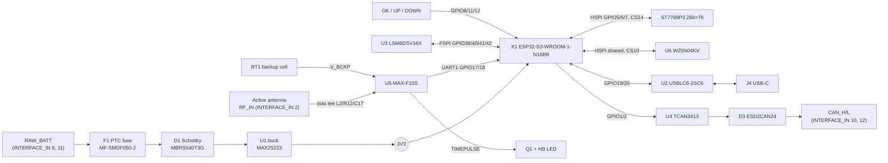

# Agile Technical Specification

Hardware revision **PCB v1.1**, firmware up to **v0.17.0**.

Sources: [schematic](../Hardware/PCB/Schematic/PLTD_v1.1_Schematics.pdf) and [board](../Hardware/PCB/Board/PLTD_v1.1_Board.pdf) prints (LibrePCB 2.0.1, 2026-10-16), [3D model](../Hardware/PCB/3D/PLTD_v1.1.step), [partitions.csv](../Firmware/tools/partitions.csv), [Pseudocode.md](Pseudocode.md) and [Architecture.md](Architecture.md). Where the schematic and the firmware disagree, the firmware v0.17.0 behaviour is given and the difference is listed in [§12](#12-known-discrepancies-and-open-items).

---

## 1. Summary

| Item | Value |
|---|---|
| Function | GNSS lap timer, micro-sector timing and driver display with pit wall link |
| MCU | Espressif ESP32-S3-WROOM-1-N16R8, dual-core Xtensa LX7, Wi-Fi 2.4 GHz |
| Memory | 16 MB quad flash (QIO 80 MHz), 8 MB octal PSRAM |
| GNSS | u-blox MAX-F10S, dual-band, 10 Hz PVT (5 Hz fallback) |
| IMU | ST LSM6DSV16X 6-axis, 240 Hz ODR, ±16 g / ±2000 dps |
| Log storage | Winbond W25N04KV, 4 Gbit (512 MB) SPI NAND |
| Display | ST7789P3 TFT, 284 × 76 px, 16-bit colour |
| Controls | 3 tactile buttons: RESET-OK, UP, DOWN |
| Comms | Wi-Fi STA (HTTP + WebSocket), USB-C (USB 2.0 full-speed device), CAN (fitted, disabled) |
| Supply | Vehicle supply `RAW_BATT` via interface connector, buck to 3.3 V |
| PCB | 90 × 30 mm, 1.6 mm, chamfered corners, two plated mounting holes |
| Mounting | Dash, board vertical, display facing the driver (`MOUNT_DASH_VERTICAL`). Pin 1 up (NORMAL) or the whole unit upside down (INVERTED, fw v0.19.0) |

## 2. Block diagram

## 3. Mechanical

| Item | Value |
|---|---|
| Outline | 90.0 × 30.0 mm, 45° corner chamfers |
| Thickness | 1.6 mm |
| Mounting | 2 × plated through holes at the USB-C end |
| Top edge | Stepped back around the X1 module antenna, plus a second notch near the USB-C end |
| Top side | TFT module on an 8-pin header, three tactile switches (RESET-OK, UP, DOWN) at the right end |
| Bottom side | All other components: MCU module, GNSS, IMU, NAND, PSU, CAN, USB-C, backup cell holder, 2 × 6 interface header |
| USB-C | J4 on the left short edge |
| Enclosure | Onshape, `Hardware/Enclosure/` (not yet exported) |

The IMU axis remap in firmware assumes the board is mounted vertically with the display facing the driver. From fw v0.19.0 the unit can also be installed upside down (INVERTED): the display rotates 180° and the IMU signs follow, and Level Now detects and saves which way up it is. A boot check warns `IMU FLIPPED? HOLD OK 10s TO RELEARN` when the averaged vertical axis reads below −0.5 g, and `IMU MOUNT? vert …G` when it reads between −0.5 and 0.5 g.

## 4. Power

### 4.1 Input path

| Ref | Part | Role |
|---|---|---|
| F1 | Bourns MF-SMDF050-2 | Resettable PTC fuse on `RAW_BATT` |
| D1 | onsemi MBRS540T3G (40 V, 5 A Schottky) | Series reverse-polarity protection, output `FUSED_BATT` |
| C1, C2 | 2.2 µF | Buck input (SUP) |
| U1 | Analog Devices MAX25223ATPB/VY+ | Automotive synchronous buck, `FUSED_BATT` → 3V3 |
| L1 | 8.2 µH | Buck inductor |
| C3 | 100 nF | Bootstrap (BST to LX) |
| C4 | 1 µF | BIAS decoupling |
| C5, C6 | 2 × 22 µF | 3V3 output |
| R1 | 1 kΩ | SPS (spread-spectrum select) pin to BIAS |
| R2 | 10 kΩ | PGOOD pull-up to BIAS (PGOOD not routed to the MCU) |

`EN` is tied to `FUSED_BATT`, so the regulator runs whenever the supply is present. `SYNC` is grounded (internal oscillator).

### 4.2 Rails

| Rail | Source | Loads |
|---|---|---|
| `RAW_BATT` | INTERFACE_IN pins 9 and 11 | F1 only |
| `FUSED_BATT` | after F1 + D1 | U1 |
| `3V3` | U1 | ESP32-S3, MAX-F10S (VCC, V_IO), LSM6DSV16X, W25N04KV, TCAN3413, TFT, HB LED, INTERFACE_IN pins 1 and 3 |
| `VCC_RF` | MAX-F10S output | Active antenna bias via R12 10 Ω + L2 27 nH |
| `V_BCKP` | BT1 | MAX-F10S backup domain (RTC, ephemeris) |
| `VBUS` | J4 USB-C | U2 ESD clamp and R5 100 kΩ only. Not connected to the regulator (see §12). |

### 4.3 Supply limits

Input voltage range, quiescent and operating current have not been measured yet. Design limits follow the MAX25223, MF-SMDF050-2 and MBRS540T3G datasheets.

## 5. MCU

| Item | Value |
|---|---|
| Module | ESP32-S3-WROOM-1-N16R8 (X1), PCB antenna |
| Flash | 16 MB quad, QIO 80 MHz (OPI flash mode fails on this module) |
| PSRAM | 8 MB OPI |
| Arduino board | "ESP32S3 Dev Module", Partition Scheme "Custom" |
| EN | R17 10 kΩ pull-up to 3V3, on ESP_PROG_TOP pin 1 |
| GPIO0 (BOOT) | R16 10 kΩ pull-up to 3V3, on ESP_PROG_BOTTOM pin 4 |
| Programming | Native USB-C (GPIO19/20), or UART0 via ESP_PROG headers |

### 5.1 Programming headers

| Header | Pin 1 | Pin 2 | Pin 3 | Pin 4 |
|---|---|---|---|---|
| ESP_PROG_TOP | ESP_EN | GND | 3V3 | GND |
| ESP_PROG_BOTTOM | GND | ESP_TXD (U0TXD) | ESP_RXD (U0RXD) | ESP_BOOT (GPIO0) |

### 5.2 Flash partition table

Shared 16 MB dual-OTA table, identical to BTTM ([partitions.csv](../Firmware/tools/partitions.csv)).

| Name | Type | Offset | Size | Use |
|---|---|---|---|---|
| nvs | data/nvs | 0x009000 | 20 KB | Wi-Fi credentials, circuits, sector map, best lap, IMU trim, thresholds |
| otadata | data/ota | 0x00E000 | 8 KB | OTA boot selection |
| app0 | app/ota_0 | 0x010000 | 4096 KB | Primary application |
| app1 | app/ota_1 | 0x410000 | 4096 KB | OTA staging slot |
| spiffs | data/spiffs | 0x810000 | 8128 KB | Reserved, unused (logs go to the external NAND) |

The `nvs`, `otadata` and `app0` offsets are fixed by the Arduino toolchain. OTA cannot migrate the partition table; a layout change needs a USB flash with "Erase All Flash" enabled once.

### 5.3 PSRAM use

Two trace buffers of 4500 points × 12 B (reference and current lap). Promotion of a new reference lap is a pointer swap. If either allocation fails the firmware falls back to a single internal buffer and reports `single trace` at boot.

## 6. GPIO map

| GPIO | Net | Direction | Function (fw v0.17.0) |
|---|---|---|---|
| 0 | ESP_BOOT | in | Strapping, 10 kΩ pull-up, ESP_PROG_BOTTOM |
| 1 | CAN_TX | out | TWAI TX to TCAN3413 TXD (CAN compiled out) |
| 2 | CAN_RX | in | TWAI RX from TCAN3413 RXD (CAN compiled out) |
| 5 | TFT_SCK & HSPI_SCK | out | HSPI SCK, shared TFT + NAND |
| 6 | TFT_SDI & HSPI_SDI | out | HSPI MOSI, shared TFT + NAND |
| 7 | HSPI_SDO | in | HSPI MISO (NAND DO) |
| 8 | OK_RST_BUTTON | in | OK button, `INPUT_PULLUP`, CHANGE interrupt |
| 10 | HSPI_CS | out | NAND chip select |
| 11 | UP_BUTTON | in | UP button, `INPUT_PULLUP`, polled |
| 12 | DOWN_BUTTON | in | DOWN button, `INPUT_PULLUP`, polled |
| 14 | TFT_CS | out | TFT chip select |
| 17 | GNSS RXD | out | UART1 TX to MAX-F10S RXD |
| 18 | GNSS TXD | in | UART1 RX from MAX-F10S TXD |
| 19 | USB− | io | USB D− |
| 20 | USB+ | io | USB D+ |
| 21 | TFT_DC | out | TFT data/command |
| 38 | IMU_SDI | out | FSPI MOSI to LSM6DSV16X SDA/SDI |
| 40 | IMU_SCK | out | FSPI SCK to LSM6DSV16X SCL/SPC |
| 41 | IMU_SDO | in | FSPI MISO from LSM6DSV16X SDO/SA0 |
| 42 | IMU_CS | out | IMU chip select |
| 47 | TFT_RESET | out | TFT reset |
| 48 | (mod wire) TFT_BL | out | Backlight PWM to the low-side MOSFET gate, fw v0.18.0 with the [backlight mod](#741-backlight-dimming-mod-fw-v0180). NC on a stock v1.1 |
| 43 / 44 | ESP_TXD / ESP_RXD | io | UART0 (U0TXD / U0RXD), on ESP_PROG_BOTTOM |
| 3, 4, 9, 13, 15, 16, 35–37, 39, 45, 46 | NC | – | Unused |

GPIO 45 and 46 are strapping pins and input-only in this design. GPIO 35–37 are taken by the octal PSRAM.

## 7. Peripherals

### 7.1 GNSS: u-blox MAX-F10S (U5)

| Item | Value |
|---|---|
| Constellations | GPS L1, Galileo E1/E5a, BeiDou B1C/B2a |
| Interface | UART1, 460800 baud, UBX in/out, NMEA out disabled |
| Rate | 10 Hz `NAV-PVT` (autoPVT); 5 Hz fallback if 10 Hz is NACKed |
| Baud negotiation | Tries 460800, 115200, 9600, 38400 (3 attempts each), then sets `CFG-UART1-BAUDRATE` 460800 |
| Fix validity | fix type ≥ 2, SIV ≥ 6, PDOP ≤ 4.0, stale after 1.5 s |
| Supply | VCC and V_IO on 3V3; C14 100 nF, C15 1 µF, C16 10 µF |
| Backup | BT1 on V_BCKP (hot start after power loss) |
| Antenna | External active antenna on `RF_IN` (INTERFACE_IN pin 2). Bias from VCC_RF via R12 10 Ω, L2 27 nH, C17 10 nF decoupling |
| I²C (DDC) | SDA/SCL pulled up 4.7 kΩ (R8, R9), not connected to the MCU |
| RESET_N, SAFEBOOT_N | 10 kΩ pull-ups to 3V3 (R4, R3) |
| LNA_EN, EXTINT, VIO_SEL | Not connected |
| TIMEPULSE | Drives Q1 (MMBTA42 NPN, R14 10 kΩ base, R15 10 kΩ pull-down) and the HB LED via R13 1 kΩ. The LED blinks with the GNSS time pulse (1 PPS by default) |

Measured rate and worst inter-epoch gap are recomputed every 10 s and shown on diagnostic page 2/5.

### 7.2 IMU: ST LSM6DSV16X (U3)

| Item | Value |
|---|---|
| Interface | FSPI, 8 MHz, SCK 40, MOSI 38, MISO 41, CS 42 |
| Configuration | WHO_AM_I check, accel ±16 g (0.004788 m/s² per LSB), gyro ±2000 dps (0.070 dps per LSB), ODR 240 Hz |
| Polling | `imuTask` every 5 ms (200 Hz) |
| Interrupts | INT1, INT2 not connected (polled) |
| Aux / QVAR | SDx, SCx, OCS_AUX, SDO_AUX not connected |
| Decoupling | C8 100 nF |
| Axis remap | `MOUNT_DASH_VERTICAL`: forward = +Z, left = +Y, up = −X, yaw rate = −gX. INVERTED (v0.19.0): forward = +Z, left = −Y, up = +X, yaw rate = +gX |
| Orientation | v0.19.0. NORMAL / INVERTED in NVS `lt_imu` key `orient`, read before the TFT starts. Level Now flips it when the vertical mean is below −0.5 g, then saves the trim and reboots (only in `LAP_IDLE` and at ≤ 5 km/h) |
| Levelling | 200-sample (~1 s) average, accepted when mean |a| is 0.85–1.15 g and SD ≤ 0.05 g. Roll and pitch trim and yaw offset stored in NVS `lt_imu` |
| Event filter | IIR, α = 0.25, on longitudinal and lateral g |

### 7.3 Storage: Winbond W25N04KV (U6)

| Item | Value |
|---|---|
| Capacity | 4 Gbit (512 MB), 4096 blocks × 64 pages × 2 KB (+ spare) |
| Interface | HSPI shared with the TFT: CLK 5, DI 6, DO 7, CS 10 |
| WP, HOLD | Tied to 3V3 (single-bit SPI) |
| Decoupling | C10 100 nF |
| Identification | JEDEC `EF AA 23` required at init |
| Init | Clear SR-1 block protect, set ECC-E and BUF, scan spare byte of page 0 of all 4096 blocks to build the good-block map |
| Format | Append-only pages: header {magic `1PAP`, session, payload_len 2032, seq, CRC32} + CSV payload |
| Sessions | One `LOG_nnnn.CSV` per boot, up to 9999 |
| Writer | `logWriterTask` only; partial page flushed after 5 s; recovery trims a page with a bad CRC |

CSV columns: `iTOW, lat_deg, lon_deg, speed_kph, sats, pdop, fix, along_g, lat_g, vert_g, yaw_dps, lap, sector, delta_ms, cumul_delta_ms, state, car_state, geo_override, geo_label`.

### 7.4 Display: ST7789P3 TFT

| Item | Value |
|---|---|
| Resolution | 284 × 76 px, driven as `tft.init(76, 284)`, rotation 3 (NORMAL) or 1 (INVERTED, v0.19.0), no inversion |
| Interface | HSPI write-only: SCK 5, SDI 6, CS 14, DC 21, RST 47 |
| Connector | 8-pin header: 1 GND, 2 VIN 3V3, 3 SCK, 4 SDI, 5 RST, 6 DC, 7 CS, 8 LED |
| Backlight | LED pin tied to GND on a stock v1.1 (always full on). With the mod below, fw v0.18.0 dims it 10–100 % from the web UI |
| Refresh | `displayTask` on core 1, 20 Hz, dirty-checked elements |
| Layout | Delta bar y 0–27, info y 29–50, sector rows y 52–73 |

The TFT and NAND share HSPI; all three chip selects are driven high before either bus is started.

#### 7.4.1 Backlight dimming mod (fw v0.18.0)

The TFT header's pin 8 (LED) is the backlight cathode return, so the switch goes on the low side. Cut pin 8's link to GND and fit an N-channel MOSFET:

| MGSF1N03LT1G pin | Connects to |
|---|---|
| 3 Drain | TFT header pin 8 (LED) |
| 2 Source | GND |
| 1 Gate | GPIO48 (WROOM-1 pad 25, next to TFT_RESET on pad 24) through 100 Ω, plus 10 kΩ to 3V3 |

| Item | Value |
|---|---|
| Polarity | Active-high: GPIO high = backlight on (`TFT_BL_ACTIVE_LOW 0`) |
| Fail-safe | The 10 kΩ gate pull-up keeps the backlight full on in reset, while booting and on an unflashed unit |
| Detection | At boot GPIO48 is read with its internal pull-down on. The 10 kΩ pull-up reads high, so the mod counts as fitted; an open pin reads low and the web card reports "not fitted". The pull-up must be 15 kΩ or less |
| PWM | LEDC 20 kHz, 10 bit, duty = level², level 10–100 % |
| Storage | NVS `lt_disp` / `bl_pct`, applied before `tft.init()` |
| Bench check | At 100 %, drain–source drop should be tens of mV. Hundreds of mV means that unit is not fully enhanced at 3.3 V |

The MGSF1N03LT1G is specified at Vgs 4.5 V (0.145 Ω max) with Vgs(th) 1.0–2.4 V, is ESD class 0 (125 V HBM), and is discontinued. On a PCB revision use an FDN337N or AO3400A, which share the SOT-23 G/S/D pinout.

### 7.5 USB-C (J4)

| Item | Value |
|---|---|
| Connector | UJ20-C-H-G-SMT-1-P16-TR, 16-pin USB-C receptacle |
| Role | Device (UFP): CC1 and CC2 pulled down with 5.1 kΩ (R6, R7) |
| Data | USB 2.0 full speed through ESP32-S3 native USB (GPIO19/20) |
| ESD | U2 USBLC6-2SC6 on D+, D−, VBUS |
| VBUS | 100 kΩ (R5) to GND; not used as a supply |
| Shield | GND |
| Modes | Serial/JTAG for flashing and debug; TinyUSB MSC in log export mode |

**Log export mode** (UP held at power-on): presents a read-only FAT16 volume synthesised on the fly from the NAND (vendor `MULLALOO`, product `PLTD LOG STORE`). Writes are rejected. Holding OK for 5 s erases every good block.

### 7.6 CAN: TI TCAN3413 (U4)

| Item | Value |
|---|---|
| Transceiver | TCAN3413DR, 3.3 V supply |
| MCU side | TXD ← GPIO1, RXD → GPIO2 (TWAI) |
| Mode pin | RS tied to GND |
| Protection | D3 ESD2CAN24DCKRQ1 on CAN_H / CAN_L |
| Decoupling | C18 100 nF, C19 10 µF 25 V |
| Bus | CAN_H pin 12, CAN_L pin 10 of INTERFACE_IN |
| Termination | None on board |
| Firmware | `CAN_ENABLED 0` in v0.17.0. When enabled: TWAI 500 kbit/s, sector events from `canTask` (20 ms) |

### 7.7 Buttons

| Button | GPIO | Electrical | Firmware handling |
|---|---|---|---|
| RESET-OK | 8 | Switch to GND, internal pull-up | CHANGE ISR, debounced; short < 700 ms, long 1.2–10 s, very long ≥ 10 s |
| UP | 11 | Switch to GND, internal pull-up | Read at power-on (USB export), polled by `lapTask` (10 s hold = erase learned state) |
| DOWN | 12 | Switch to GND, internal pull-up | Read at power-on (diagnostic pages), polled on the approve screen |

No external pull-ups or RC debounce are fitted.

### 7.8 Status LED

| Ref | Function |
|---|---|
| HB | GNSS TIMEPULSE heartbeat (Q1 driven), no MCU control |

## 8. Interface connector (INTERFACE_IN)

2 × 6 through-hole header.

| Pin | Signal | Pin | Signal |
|---|---|---|---|
| 1 | 3V3 (out) | 2 | RF_IN (active GNSS antenna) |
| 3 | 3V3 (out) | 4 | GND |
| 5 | GND | 6 | GND |
| 7 | GND | 8 | GND |
| 9 | RAW_BATT (in) | 10 | CAN_L |
| 11 | RAW_BATT (in) | 12 | CAN_H |

## 9. Firmware resource map (v0.17.0)

| Task | Core | Priority | Stack | Period | Role |
|---|---|---|---|---|---|
| `gnss` | 0 | 3 | – | 20 ms | Drain autoPVT, measure rate, latest fix to `gnssQueue` |
| `imu` | 0 | 3 | 2048 | 5 ms | Read IMU, remap, trim, IIR, levelling |
| `lap` | 0 | 4 | 12288 | 10 ms | Buttons, geofence, S/F crossing, state machine, delta, logging |
| `logw` | 0 | 1 | 4096 | queue, 250 ms | Only NAND writer |
| `disp` | 1 | 2 | 4096 | 50 ms | TFT rendering, 10 Hz WebSocket `live` push |
| `wifi` | 0 | 1 | – | 2 s | STA connect and retry, starts the web server |
| `can` | 0 | 2 | 2048 | 20 ms | Compiled out |

| Bus | Clock | Devices |
|---|---|---|
| UART1 | 460800 baud | MAX-F10S |
| Serial | 115200 baud | Debug console (`Serial`) |
| FSPI | 8 MHz | LSM6DSV16X |
| HSPI | shared | ST7789P3, W25N04KV |
| USB | 12 Mbit/s | CDC / JTAG, or TinyUSB MSC in export mode |
| TWAI | 500 kbit/s | TCAN3413 (disabled) |

## 10. Wireless

| Item | Value |
|---|---|
| Mode | Wi-Fi STA, 2.4 GHz, DHCP (`WIFI_USE_STATIC_IP 0`) |
| Credentials | Compiled default, overridden by NVS `pltd-wifi` |
| Reconnect | Immediate on disconnect; retry every 3 s; interface reset after 3 failures |
| Services | HTTP web UI, `/ws` WebSocket, `/data` JSON, `POST /update` OTA (Basic auth) |
| OTA gate | State IDLE and speed ≤ 5 km/h; tasks quiesced, NAND page committed before writing |
| Network | Trackside AP on 192.168.0.x; pit wall over the same AP or via WireGuard |

API detail: [Interface.md](Interface.md). Web UI: [WebUI.md](WebUI.md).

## 11. Bill of materials (v1.1, from schematic)

| Ref | Value / part | Function |
|---|---|---|
| X1 | ESP32-S3-WROOM-1-N16R8 | MCU module |
| U1 | MAX25223ATPB/VY+ | 3.3 V buck |
| U2 | USBLC6-2SC6 | USB ESD |
| U3 | LSM6DSV16XTR | IMU |
| U4 | TCAN3413DR | CAN transceiver |
| U5 | MAX-F10S-00B | GNSS receiver |
| U6 | W25N04KVZEIR | 4 Gbit SPI NAND |
| D1 | MBRS540T3G | Reverse-polarity Schottky |
| D3 | ESD2CAN24DCKRQ1 | CAN ESD |
| Q1 | MMBTA42 | HB LED driver |
| HB | LED | GNSS heartbeat |
| F1 | MF-SMDF050-2 | PTC fuse |
| L1 | 8.2 µH | Buck inductor |
| L2 | 27 nH | Antenna bias choke |
| J4 | UJ20-C-H-G-SMT-1-P16-TR | USB-C receptacle |
| INTERFACE_IN | 2 × 6 header | Power, CAN, antenna |
| ESP_PROG_TOP, ESP_PROG_BOTTOM | 1 × 4 headers | Programming / debug |
| TFT | ST7789P3 76 × 284 module, 8-pin | Driver display |
| BT1 | Backup cell + holder | GNSS V_BCKP |
| RESET-OK, UP, DOWN | Tactile switch | Driver controls |
| C1, C2 | 2.2 µF | Buck input |
| C3 | 100 nF | Buck bootstrap |
| C4 | 1 µF | Buck BIAS |
| C5, C6 | 22 µF | 3V3 output |
| C8 | 100 nF | IMU decoupling |
| C10 | 100 nF | NAND decoupling |
| C14 / C15 / C16 | 100 nF / 1 µF / 10 µF | GNSS decoupling |
| C17 | 10 nF | Antenna bias filter |
| C18 / C19 | 100 nF / 10 µF 25 V | CAN decoupling |
| R1 | 1 kΩ | Buck SPS |
| R2 | 10 kΩ | Buck PGOOD pull-up |
| R3, R4 | 10 kΩ | GNSS SAFEBOOT_N, RESET_N pull-ups |
| R5 | 100 kΩ | VBUS bleed |
| R6, R7 | 5.1 kΩ | USB-C CC pull-downs |
| R8, R9 | 4.7 kΩ | GNSS I²C pull-ups |
| R12 | 10 Ω | Antenna bias |
| R13 | 1 kΩ | HB LED |
| R14, R15 | 10 kΩ | Q1 base, base pull-down |
| R16, R17 | 10 kΩ | BOOT, EN pull-ups |

The fabrication BOM and CPL go in `Hardware/Fabrication/v1.1/` once exported.

## 12. Known discrepancies and open items

| # | Item | Detail |
|---|---|---|
| 1 | Stale schematic labels | GPIO17/18 are labelled `uBlox_NEO-M8_RXD/TXD`; the part is a MAX-F10S. GPIO41 is labelled `TFT_SDO (MISO) & IMU_SDO (MISO)`; the TFT has no MISO pin and firmware uses GPIO41 for the IMU only (HSPI MISO is GPIO7). |
| 2 | Stale [Hardware/README.md](../Hardware/README.md) | Lists NEO-M9N GNSS, microSD storage and display TBD. v1.1 uses MAX-F10S, W25N04KV NAND and the ST7789P3. |
| 3 | [pcb_changelog.txt](../Hardware/pcb_changelog.txt) | Only has a v0.1 entry; v1.1 is not recorded. |
| 4 | USB power | VBUS only reaches the ESD clamp and R5. The board cannot run from USB alone, so flashing and log export need `RAW_BATT` on INTERFACE_IN. |
| 5 | Schematic page 4 (BATT) | Marked TBD. |
| 6 | EN reset timing | No RC capacitor on ESP_EN shown (R17 pull-up only). Espressif recommends 1 µF on EN. |
| 7 | CAN termination | No 120 Ω on board; the bus must be terminated externally. |
| 8 | TFT backlight | LED pin hard-wired to GND on the PCB. Dimming needs the [§7.4.1](#741-backlight-dimming-mod-fw-v0180) rework (fw v0.18.0); a PCB revision should route a SOT-23 N-MOSFET and GPIO48 on the board. |
| 9 | BT1 | Cell type and holder part not given on the schematic. |
| 10 | Power figures | Input voltage range, current draw and thermal behaviour not yet characterised. |
| 11 | Fabrication outputs | Gerber, BOM and CPL for v1.1 not yet in `Hardware/Fabrication/`. |
