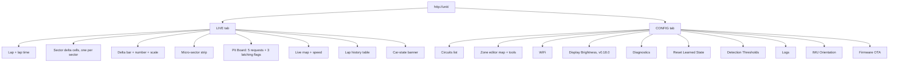
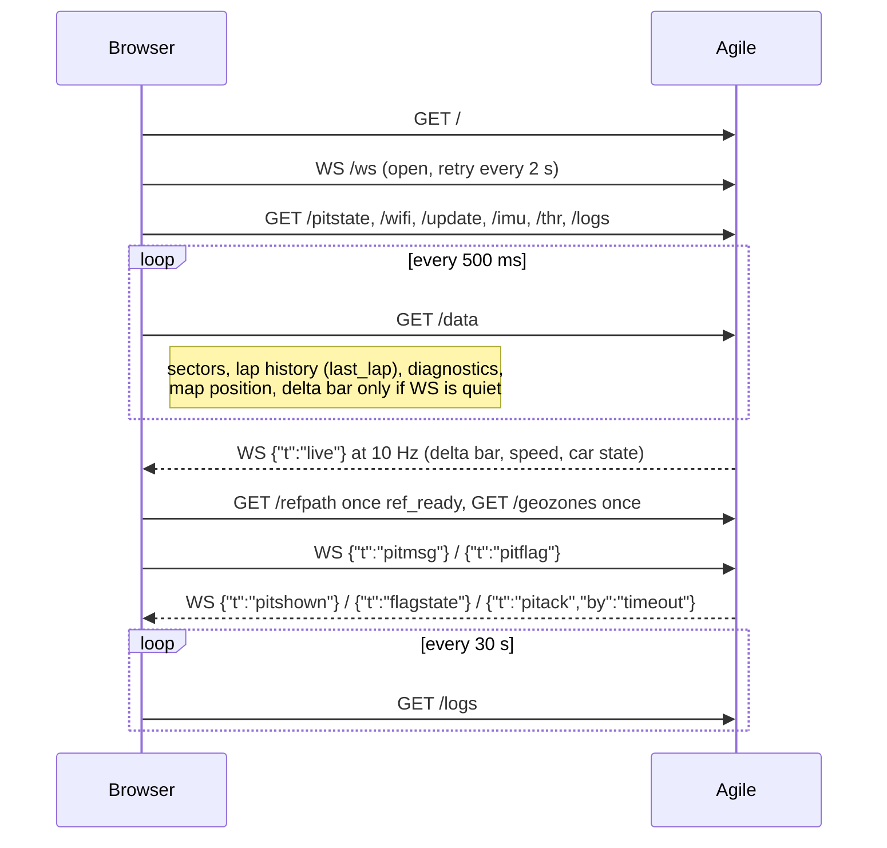

# Agile Web Interface, firmware v0.17.0

Agile serves a single-page web app on port 80 once it has joined Wi-Fi. Open `http://<unit-ip>/`. The IP is on the idle screen, row 5. The page and its JavaScript are compiled into the firmware (`HTML_HEAD` and `HTML_SCRIPT` in PROGMEM). Leaflet 1.9.4 and the map tiles (OpenStreetMap, Esri World Imagery) come from the internet, so the **browser** needs a route out; the unit does not.

The screenshots below are the real page from the v0.17.0 source, served by [`WebUI/mock_server.py`](WebUI/mock_server.py) with mock data. The circuit geometry is synthetic. The mock does not emulate the WebSocket, so the pit-board status line reads "disconnected — retrying" and the bar runs on its `/data` fallback.

```bash
python Documentation/WebUI/mock_server.py path/to/LapTimer_v0_17_0.ino 8765
```

## Page structure



## Data flow



## LIVE tab


| Element | Source | Behaviour |
|---|---|---|
| **Lap / Lap Time** | `/data` `lap_number`, `lap_elapsed_ms` | Current lap and elapsed time, `m:ss.mmm`. |
| **Sector cells** S1…Sn | `/data` `sectors[]`, `sector_count`, `current_sector` | One cell per detected sector. 4 per row up to 8 sectors, 6 up to 18, 8 above that. Completed: delta `±s.mmm` in the sector colour. Active: `...`. Not reached: `--`. |
| **Delta bar** | WS `live` (`d`, `v`, `tl`, `br`), else `/data` | Same rules as the TFT: red fills left when losing, green right when gaining, soft knee, EMA 0.35, scale from the device (`±2s` label top right). Amber box when the delta is invalid or `timing_live` is false (pits / stationary). |
| **Delta number** | same | `±s.sss`; gray within ±10 ms, `---` when invalid. |
| **Micro-sector strip** | `/data` | One block per sector: gray/green/red/purple when done, white for the active one, dark gray otherwise. |
| **Pit Board** | WS | See below. |
| **Live map** | `/data` `lat/lon`, `/refpath`, `/geozones` | Car dot follows the unit. The reference lap outline loads once `ref_ready` is true (decimated to ~800 points). The armed circuit's zones are drawn with labels. Street/Satellite switch plus optional place labels. Speed badge top right. |
| **Lap history** | `/data` `last_lap`, `last_sectors` | One row per completed lap seen while the page is open, newest first. `REF` marks a lap that became the reference. Delta is red/green. History lives in the browser only and is lost on reload. |
| **Status banner** | `car_state` | RUNNING (green), PIT ENTRY (amber), PITS (blue), PIT EXIT (yellow), FUELLING (purple); `• PIT LAP` appended while the lap touched the pits. |

### Pit Board

| Button | Sent | Unit shows | Clears |
|---|---|---|---|
| PIT REQUEST, UPDATE REQUEST, MORE PACE, LESS PACE | `{"t":"pitmsg","text":…,"pri":0}` | white on blue | after 5 s |
| PIT NOW | `{"t":"pitmsg","text":"PIT NOW","pri":1}` | white on blue, wins over pri 0 | after 5 s |
| SAFETY CAR, YELLOW FLAG, RED FLAG | `{"t":"pitflag","name":…,"on":true\|false}` | latched, priority 2 | only when clicked off |

The flag buttons never toggle themselves. They send the intent and repaint from the `flagstate` broadcast, so two laptops on the pit wall always agree. A latched flag gets a white outline and `• ON`. `UPDATE REQUEST` is sent as the text `UPDATE REQ`.

## CONFIG tab


### Circuits and zone editor

A **circuit** is one object: the S/F line plus the pit and fuel zones, stored in NVS (`lt_geo`, one JSON string per circuit, about 3.9 KB maximum each).

| Tool | Zone type | Shape | Used for |
|---|---|---|---|
| Start / Finish | 6 `ZONE_SF_LINE` | 2-point line, drawn thicker | lap trigger; lay it **across both the track and the pit lane** |
| Pit Entry Line | 1 | 2-point line | RUNNING → PIT ENTRY |
| Pit Exit Line | 2 | 2-point line | → PIT EXIT |
| Pits Zone | 3 | polygon (3+ points) | PIT ENTRY → PITS, PITS → PIT EXIT |
| Fuel Zone | 4 | polygon | PITS ↔ FUELLING |
| Custom | 5 | polygon | full-screen label on the TFT while inside |

Workflow:

1. **+ Add Circuit** (the name must not contain a comma), or click an existing circuit.
2. Pick a tool and click the map: 2 points for a line, 3 or more for a polygon. **Clear Draft** starts the shape again.
3. **Save Config** adds the draft to the circuit and stores it (`POST /geo/save`). Lines are cut to exactly two points.
4. **Load to Device** arms it on the unit (`POST /geo/load`) and makes it the boot default. The list then marks it **ON DEVICE**.
5. Zones can be removed with ✕ in the zone list; press Save Config afterwards.
6. **Delete Circuit** removes it from NVS (`POST /geo/delete`).

### WiFi

Shows the SSID, IP, mode (dhcp/static), RSSI, and whether the credentials came from NVS or the compiled default. **Save & Reconnect** stores new credentials and reconnects at once. **Use Defaults** clears NVS. If the IP changes, reload the page from the new address.

### Display Brightness (v0.18.0)

TFT backlight, 10–100 %. Dragging the slider previews the level live (`POST /brightness {"level":N,"save":false}`, at most every 120 ms) without writing flash; releasing it, or pressing **Day** (100), **Dusk** (50) or **Night** (20), saves to NVS `lt_disp`. The saved level is applied at boot before the first screen is drawn. On a board without the [backlight mod](TechnicalSpec.md#741-backlight-dimming-mod-fw-v0180) the card reads "Backlight control not fitted on this unit" and the display stays at full brightness.

### Diagnostics

Mirrors the TFT boot pages and refreshes with every `/data` poll:

- GNSS: rate (green if it matches the request), baud, autoPVT, NACKs, measured Hz, worst gap
- Band plan
- Geo: the armed circuit and zone count, or `NO CIRCUIT ARMED — press Load to Device`
- S/F: `line, Nm, 2 pts`, `drawn as a polygon`, or `NOT ARMED — no crossing will ever register`
- Style and adaptive gate, the synthesis stage counts, level trim status, reference lap time

### Reset Learned State

Type `ERASE`, optionally tick **also forget the S/F line**, confirm. Sends `POST /nuke {"confirm":"ERASE","sf":bool}`. This wipes the sector map, best lap and traces. Zones, Wi-Fi, IMU trim and thresholds are kept. It is the same as holding UP for 10 s on the unit.

### Detection Thresholds

Braking / cornering / acceleration (g) and the minimum event duration (ms). They are stored in NVS `lt_thr` (`POST /thr`, range 0.05–2.0 g, 50–3000 ms). The **Road** preset is 0.20/0.28/0.16 and **Circuit** is 0.30/0.40/0.25; a preset only fills the fields, press Save to store it. Since v0.15.0 the recon lap detects candidates at fixed floors (0.08/0.10/0.08 g) and an adaptive gate selects from them, so these values mainly matter as the reporting thresholds.

### Logs

Current session, % of the NAND used, and a download link per session (`GET /log?id=N`, streamed CSV). Wiping is only possible in USB export mode.

### IMU Orientation

Orientation, roll, pitch and yaw trim. **Level Now** (`POST /imu/level`) captures roll and pitch from gravity; the car must be still and level. From v0.19.0 it also detects a unit installed upside down: it flips the orientation (display and IMU together), saves the trim, reboots, and the card follows the reboot. The **Unit orientation** selector (`POST /imu/orient`) sets it by hand as a bench fallback. The **yaw offset** is entered by hand (`POST /imu/yaw`). When two consecutive laps agree, a GPS-learned **Suggested yaw** appears with an **Apply** button. It is never applied automatically.

### Firmware (OTA)

Shows the running and target partition, sketch size and version. **Upload & Flash** posts the `.bin` (multipart field `update`) with HTTP Basic auth (user from `/update`, password typed in the card). The unit refuses unless it is in `LAP_IDLE` and at 5 km/h or less; the card shows `Blocked: lap in progress` or `vehicle moving`. On success the unit commits its log page, reboots, and the page reloads after 15 s. **Reboot** does the same without flashing.

## Web UI findings in v0.17.0

| # | Where | Observation |
|---|---|---|
| 1 | Lap history table | The header and `rebuildHist()` are still fixed at **S1–S3**, so on a 9-sector map only the first three split times appear. The live sector row was fixed in v0.17.0; this table was not. |
| 2 | IMU card | "No yaw suggestion yet — needs a lap above 25 km/h". Since v0.14.0 the firmware needs 1500 samples above **40 km/h** and two agreeing laps. |
| 3 | Config map | The v0.16.2 notes promise a direction arrow at the S/F midpoint. The code draws a thicker line and a label but no arrow. |
| 4 | Pit status line | A `pitack` with `by:"timeout"` is shown as "Msg #n expired." `pitshown` says "on driver display (5 s)" also for PIT NOW, which follows the same 5 s timeout. |
| 5 | `/sf/set` | Still served (legacy point S/F, and it erases the sector map), but nothing in the page calls it since v0.16.0. |
